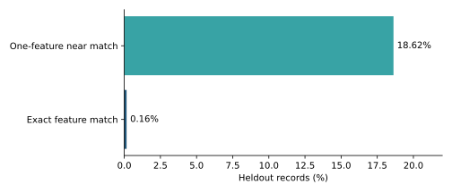

# Split Sentinel

A Python toolkit for reviewing train/test CSV splits. It checks repeated feature
vectors, entity and time overlap, missing values, target proxies and distribution
shift. Findings explain what was detected; they do not prove harmful leakage.

## Notebooks

- [Main implementation](notebooks/00_main_audit.ipynb): complete audit code, source preparation, a real Adult run, package agreement and match-rate plots.
- [Data exploration](notebooks/01_data_exploration.ipynb): missingness, age, working hours and workclass distributions.
- [Diagnostics](notebooks/02_diagnostics_and_validation.ipynb): independent near-match verification, threshold sensitivity and optional label-quality checks.

These notebooks contain executed aggregate outputs. Downloaded records remain local.



## Run

```bash
python -m pip install -e ".[dev]"
python -m leakage_audit.adult_validation
leakage-audit data/processed/adult/train.csv data/processed/adult/test.csv --target target --check-near-duplicates --output data/interim/audit.json
python -m pytest -q
```

For notebooks, also install `jupyterlab matplotlib numpy`.
Use `--fail-on-high` to gate a pipeline: exit 1 means a high-severity finding;
invalid input exits 2. Without that flag, a valid audit exits 0.

## Real-data result

The unchanged official UCI Adult split has 32,561 training and 16,281 heldout rows.
The scanner finds 26 exact feature matches and 3,032 one-feature near matches;
2,953 near matches differ only in survey weight. Independent reference algorithms
agree with the counts. This is not a detection-accuracy score: person identifiers
and leakage ground truth are unavailable.

Default checks ignore heldout labels. Enable target-quality inspection explicitly
with `--check-target-quality`. Near matching is exact in every other feature;
there is no implicit numeric tolerance or learned similarity.

[Report](Report.md) covers validation and limitations.
[Methodology](docs/methodology.md) defines the checks and source attribution.

The Adult audit uses all 48,842 official rows, retaining duplicates and missing values. The [coverage audit](docs/dataset-coverage.json) records both official split counts and exact source hashes; there is no row subsample.
